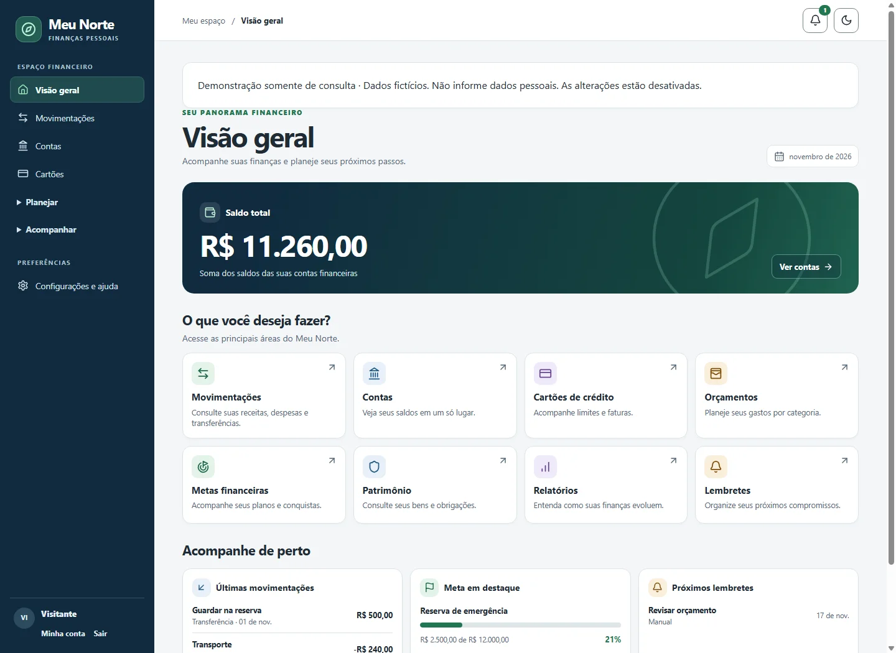
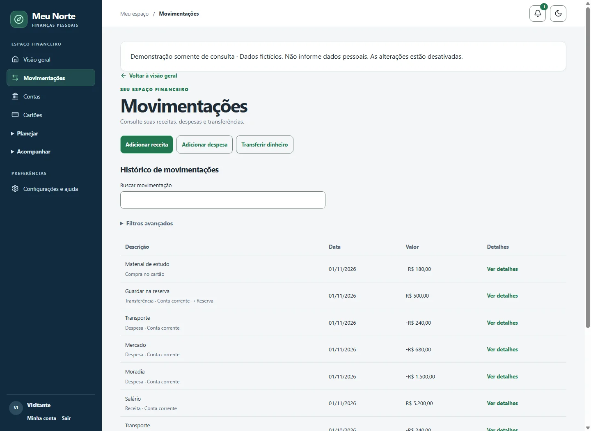
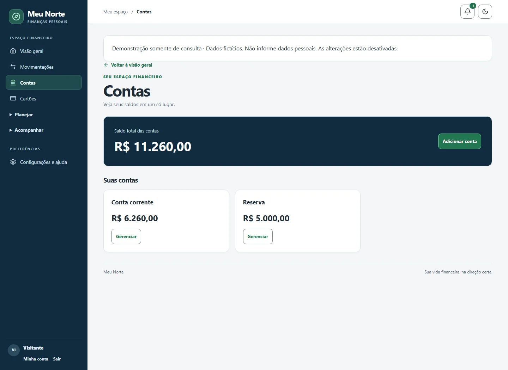
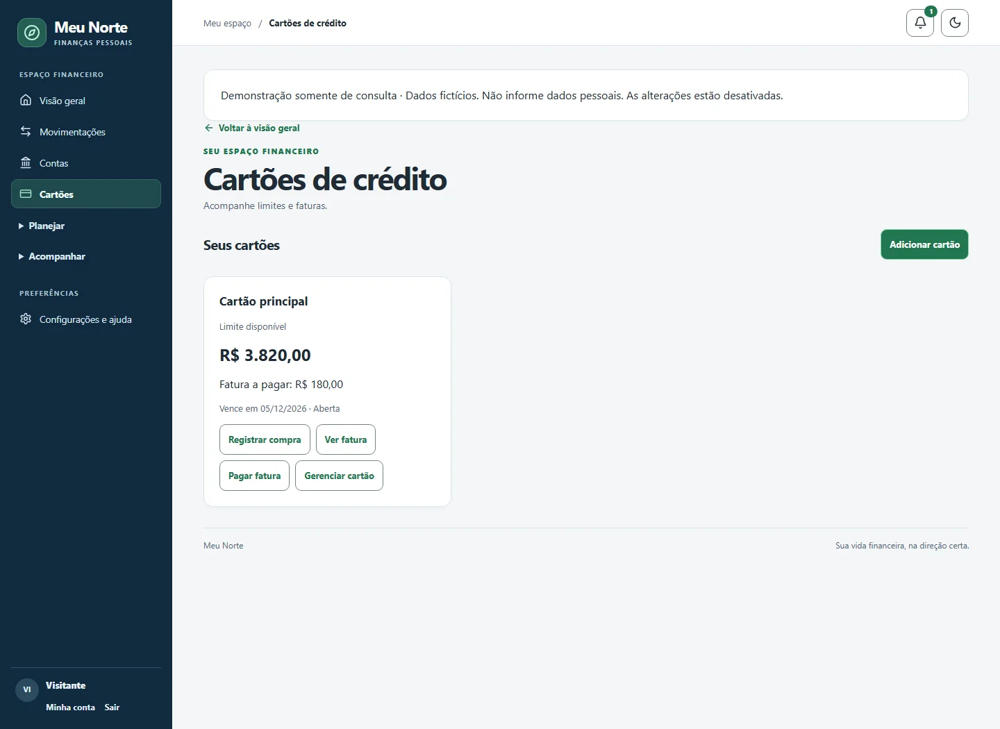
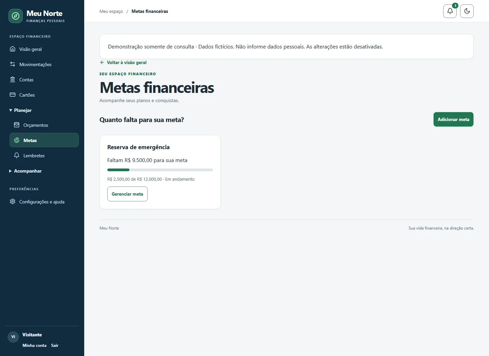
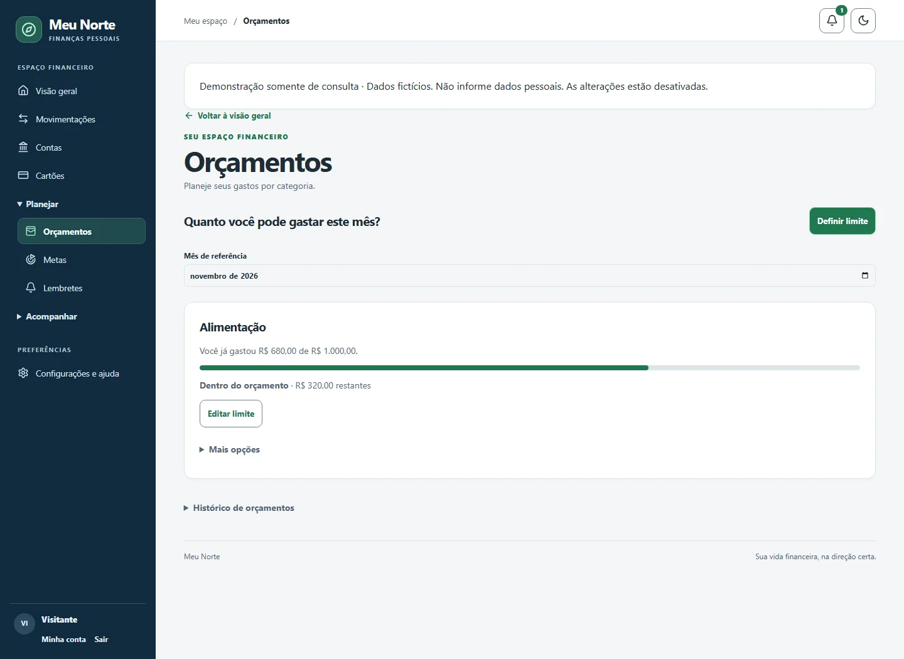
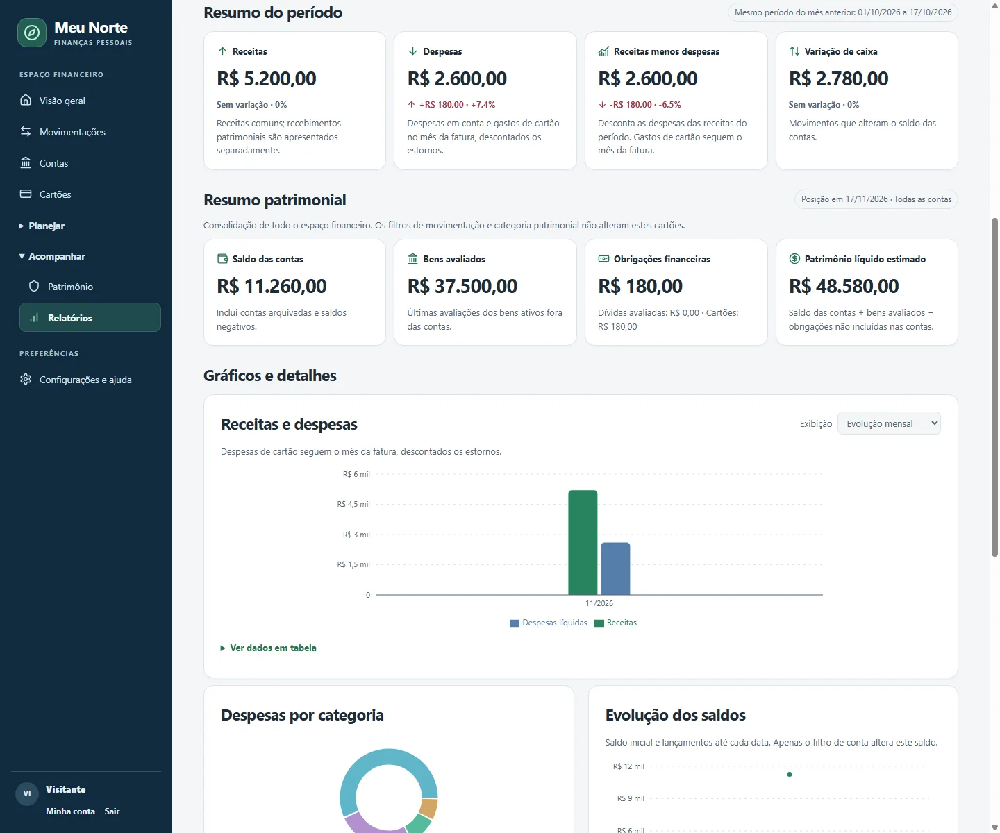
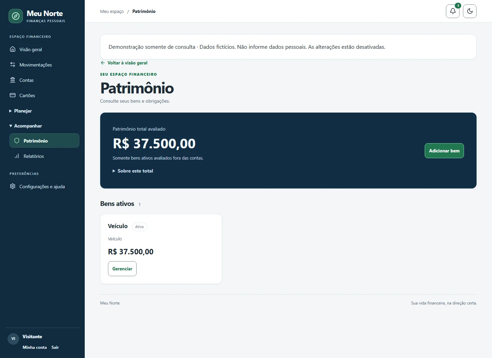

<div align="center">
  
  <h1>Meu Norte</h1>
  <p><strong>Direção Financeira</strong></p>
  <p>Organize suas finanças. Planeje seu futuro.</p>
  <p>Gestão financeira pessoal em uma aplicação web Full Stack.</p>
  <p>
    
    
    
    
    
    
    
  </p>
  <p>Por <a href="https://github.com/0-GBL">Gabriel Araujo</a> · Desenvolvedor Full Stack em formação.</p>
  <p><a href="#demonstração">Demonstração</a> · <a href="#capturas-de-tela">Interface</a> · <a href="#instalação-e-execução-local">Execução</a> · <a href="#sobre-o-desenvolvedor">Contato</a></p>
</div>

## Sobre o projeto

O Meu Norte reúne contas, movimentações, cartões, orçamentos, metas e patrimônio para ajudar pessoas a organizar suas finanças em uma interface clara e intuitiva.

Desenvolvido como projeto de aprendizado e portfólio profissional, aplica conceitos de frontend e backend, autenticação, persistência de dados, integridade financeira e experiência do usuário. Campos opcionais e recursos avançados aparecem sob demanda, preservando a simplicidade das operações comuns.

## Demonstração

**Acesso administrativo e demonstração na mesma aplicação, quando habilitados no ambiente. Ainda não há implantação online validada.**

A demonstração usa dados fictícios estáticos, sem conexão ao MongoDB. Para habilitá-la, configure apenas `DEMO_MODE=true`, `DEMO_EMAIL=demo@example.com` e `DEMO_PASSWORD=NorteDemo@123` no backend. A configuração local permanente foi validada com os comandos normais de inicialização. [Configuração e validação](docs/CONFIGURACAO-PERMANENTE.md).

A conta de portfólio permite consultar todos os módulos com dados fictícios, sem cadastro ou configuração de administrador. É **somente de consulta**: alterações financeiras, troca de credenciais e recuperação de senha são bloqueadas pelo servidor, preservando a experiência entre visitantes.

Utilize o formulário de login existente com as credenciais fixas abaixo. Não há troca obrigatória de senha no primeiro acesso. O administrador continua entrando com seu e-mail e senha habituais, na mesma tela:

| Acesso público exclusivo da demonstração | Valor |
| --- | --- |
| E-mail | `demo@example.com` |
| Senha | `NorteDemo@123` |

Essas credenciais foram implementadas e validadas localmente. Não pertencem ao administrador. A mesma API valida a sessão demo e fornece somente o conjunto fictício, sem consultar o banco pessoal. **Não utilize a demonstração para guardar informações pessoais.**

[Como funciona o isolamento e quais são os limites](docs/DEMONSTRACAO.md).

## Capturas de tela

Interface real, capturada em Chrome com banco temporário e dados exclusivamente fictícios. O dashboard abaixo acompanha o tema do GitHub.

<picture>
  <source media="(prefers-color-scheme: dark)" srcset="docs/images/tema-escuro.webp" />
  
</picture>

<details>
<summary>Explorar movimentações, contas, cartões, planejamento, relatórios e versão mobile</summary>

### Movimentações



### Contas e cartões





### Planejamento financeiro





### Relatórios e patrimônio





### No celular


</details>

## Principais funcionalidades

- **Contas e movimentações:** saldos, receitas, despesas, transferências, filtros e histórico.
- **Cartões:** compras parceladas, faturas, pagamentos parciais, estornos e encargos.
- **Planejamento:** orçamentos por mês e categoria, metas e acompanhamento do progresso.
- **Patrimônio:** bens, atualização de valores, vendas, recebimentos e retiradas com histórico.
- **Lembretes:** compromissos recorrentes e notificações internas com confirmação manual.
- **Relatórios:** resumo financeiro, gráficos e comparação entre períodos, distinguindo despesas, caixa e patrimônio.
- **Acesso e interface:** login por e-mail e senha, sessão persistente, temas claro/escuro e layout responsivo.

## Tecnologias utilizadas

| Área | Tecnologias |
| --- | --- |
| Frontend | JavaScript, React 19, React Router 7, Vite 7 e Tailwind CSS 4 |
| Gráficos e ícones | Recharts e Lucide React |
| Backend | Node.js, Express 5, Mongoose 9, bcryptjs, Nodemailer e dotenv |
| Dados | MongoDB com replica set e transações |
| Testes | `node:test`, `mongodb-memory-server` e Chrome headless via DevTools Protocol |

## Arquitetura do sistema

```text
Usuário → React + Vite → API REST (Node.js + Express) → MongoDB (Mongoose)
                              ↕
                     Sessões e validações
```

A API identifica o espaço financeiro pela sessão, valida os dados no backend e protege operações relacionadas com transações MongoDB. Chaves de idempotência evitam repetir envios financeiros; cancelamentos preservam referências e histórico. As regras compartilhadas ficam em `shared/`.

<details>
<summary>Estrutura do repositório</summary>

```text
backend/src/       API, autenticação, modelos, regras e testes
backend/scripts/   testes isolados e diagnóstico de configuração
frontend/src/      páginas, componentes e contexto de sessão/dados
frontend/scripts/  testes de navegador e geração de capturas reais
shared/            validações e regras de datas compartilhadas
docs/              execução, demonstração, hospedagem e imagens
VALIDACAO_FINAL.md evidências históricas preservadas
```

</details>

## Instalação e execução local

Requer **Node.js 22.12+**, npm e Chrome para os testes de navegador. No PowerShell, use `npm.cmd` se a política bloquear `npm.ps1`.

### Uma API para os dois acessos

Instale as dependências na raiz:

```powershell
npm --prefix backend ci
npm --prefix frontend ci
```

Configure uma vez o ambiente do backend conforme [Demonstração](docs/DEMONSTRACAO.md). Preserve `MONGODB_URI` e todas as configurações administrativas existentes. A demonstração fica desativada por padrão em novas instalações; para habilitá-la, acrescente:

```ini
DEMO_MODE=true
DEMO_EMAIL=demo@example.com
DEMO_PASSWORD=NorteDemo@123
```

Inicie normalmente, em terminais separados:

```powershell
npm --prefix backend run dev
npm --prefix frontend run dev
```

Abra [localhost:5173/entrar](http://localhost:5173/entrar). O administrador usa seu acesso habitual; o visitante informa as credenciais públicas no mesmo formulário. Os dados fictícios são carregados de um JSON do backend. Não há segundo banco, criação de usuário demo no MongoDB, servidor adicional ou comando por visitante.

Uma instalação nova segue as instruções de administrador do [guia de desenvolvimento](docs/DESENVOLVIMENTO.md#como-executar-localmente). Não refaça o cadastro nem altere a senha de uma conta administrativa já existente.

Na hospedagem, o mesmo serviço Render executa `npm --prefix backend start` e mantém os dois acessos após a configuração inicial. Frontend, proxy HTTPS e banco administrativo no Atlas estão descritos em [Hospedagem](docs/HOSPEDAGEM.md). Nenhum deploy foi executado.


## Testes e qualidade

```powershell
npm --prefix backend run test:isolated
npm --prefix frontend test
npm --prefix frontend run build
npm --prefix frontend run test:app-browser
npm --prefix frontend run test:reports-browser
npm --prefix frontend run test:login-live
```

As integrações administrativas utilizam MongoDB temporário local e dados fictícios. `test:login-live` valida a configuração permanente: inicia e encerra os dois servidores normais, usa Chrome e confere, por leitura, a integridade dos registros pessoais. Exige as portas 3001/5173 livres e o `.env` local configurado. Não substitui variáveis ou cria bancos. Não direcione testes de escrita ao Atlas pessoal. As imagens anteriores são preservadas; veja [docs/images](docs/images/README.md).

Validação local de **18/11/2026**: **67 testes de backend, 16 de frontend e 6 cenários de login permanente aprovados**, além do build de produção. A validação administrativa no navegador cobriu **15 fluxos integrados**. A auditoria visual anterior permanece documentada, sem homologar uma implantação pública.

Resultados do acesso combinado e limites: [Validação do acesso de demonstração](docs/VALIDACAO-ACESSO-DEMO.md). A entrega visual anterior está no [Relatório de portfólio](docs/VALIDACAO-PORTFOLIO.md). As evidências anteriores continuam em [VALIDACAO_FINAL.md](VALIDACAO_FINAL.md).

## Segurança e limitações

- Senhas protegidas por hash; sessões com validade, cookies HttpOnly/SameSite Strict e Secure em HTTPS.
- Verificação de origem e isolamento dos registros por espaço financeiro no backend.
- Demonstração desativada por padrão, com dados estáticos e somente de consulta. Sessão demo em memória por uma hora: sobrevive ao refresh; após reiniciar a API ou expirar, basta entrar novamente. Sessões administrativas continuam no MongoDB.
- Sem integração bancária automática ou geração automática de receitas/despesas recorrentes. Recebimentos patrimoniais são integrais; recorrência é restrita a lembretes.
- Não há implantação pública homologada. HTTPS/proxy/cookies, SMTP, backups, volume e dispositivos físicos ainda exigem validação no ambiente hospedado.

As regras financeiras e limitações detalhadas estão no [guia técnico](docs/DESENVOLVIMENTO.md#segurança-e-limitações-conhecidas). Nunca publique arquivos `.env`, credenciais privadas ou dados pessoais; as credenciais públicas de demonstração são a única exceção intencional.

## Sobre o desenvolvedor

Sou **Gabriel Araujo**, Desenvolvedor Full Stack em formação, com foco no ecossistema JavaScript e interesse na construção de aplicações web modernas, funcionais e intuitivas.

O Meu Norte representa a aplicação prática dos meus estudos em desenvolvimento frontend, backend, banco de dados e arquitetura de sistemas web.

- GitHub: [0-GBL](https://github.com/0-GBL)
- LinkedIn: [Gabriel Araujo](https://www.linkedin.com/in/gabriel-araujo-5929a72ba/)
- E-mail profissional: [araujo.gabriel3289@gmail.com](mailto:araujo.gabriel3289@gmail.com)
