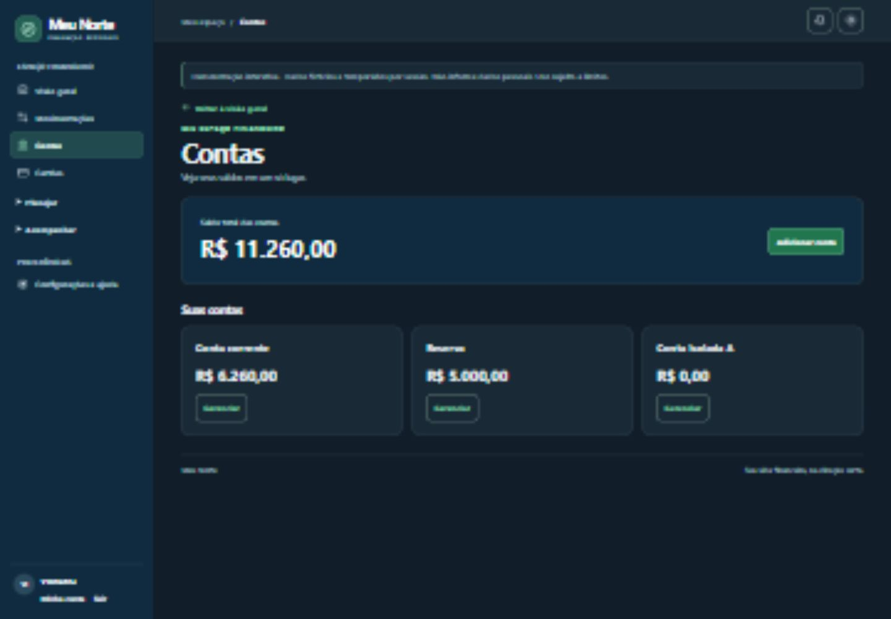

# Meu Norte — relatório de refinamento

Data: **18/11/2026**. Alterações locais, sem commit, push ou deploy. O arquivo `.env` real, a senha administrativa e os registros financeiros pessoais não foram modificados por esta revisão.

## 1. Funcionalidades da demonstração

O formulário e as credenciais continuam **demo@example.com / NorteDemo@123**. A demonstração permite criar, editar e excluir contas conforme as regras existentes; registrar e cancelar movimentações; transferir valores; cadastrar cartões, compras e pagamentos; gerenciar orçamentos, metas, bens, avaliações, vendas, recebimentos e lembretes. Saldos, históricos e relatórios usam o resultado real das operações no backend.

As rotas financeiras e seus cálculos são compartilhados com o administrador. O armazenamento demo usa os schemas existentes para tipos e valores padrão, sem executar consultas MongoDB. Não há operação simulada apenas na interface, novo módulo financeiro, banco adicional ou novo usuário Atlas.

## 2. Limites

`DEMO_DAILY_WRITE_LIMIT` assume **50 escritas concluídas por dia civil de America/Sao_Paulo e por sessão**. Configuração aceita inteiro de 1 a 1000. Uma ação com várias alterações internas conta uma vez. Erros, consultas, login/logout, duplicatas idempotentes e gravações sem mudança não consomem essa cota.

Ao ultrapassar a cota, HTTP 429 apresenta a mensagem solicitada e mantém sessão e consultas disponíveis. Transações serializadas impedem que escritas simultâneas ultrapassem a última operação disponível. O backend também limita frequência, logins simultâneos, sessões por endereço, escritas acumuladas por endereço e capacidade. A tabela completa está em [DEMONSTRACAO.md](DEMONSTRACAO.md).

## 3. Isolamento e segurança

Cada sessão recebe uma cópia própria do JSON fictício, exclusivamente em memória. Cookie separado e token aleatório com hash no servidor identificam a cópia. O proprietário nunca é escolhido pelo frontend. Cookie demo adulterado ou vencido não cai no fluxo administrativo. Troca e recuperação da senha pública continuam bloqueadas no backend.

Cada transação publica sua cópia somente após sucesso, capacidade e cota aprovados. Falhas não deixam alterações parciais. A fila admite até oito transações por sessão. Há até 200 sessões ativas, 512 KiB serializados e 1500 registros por sessão. Logout e novo login descartam a cópia anterior; expiração absoluta em uma hora e varredura periódica liberam sessões antigas. Transações verificam revogação antes de publicar.

Origem exata, cookies HttpOnly/SameSite Strict e Secure/__Host- em HTTPS foram preservados. Os controles demo não se aplicam ao administrador. Testes verificam o caminho administrativo em MongoDB local descartável e interceptam os métodos dos modelos persistentes para comprovar que escritas demo não os chamam.

## 4. Favicon

`frontend/public/favicon.svg` reaproveita o traçado da bússola existente, em azul-marinho e verde-menta, com contorno visível sobre fundos claros e escuros. O HTML referencia `/favicon.svg`, contém descrição profissional e título **Meu Norte — Direção Financeira**. O React mantém esse título na navegação. O SVG foi carregado no navegador e incluído no build. Não havia referência ativa a ícone Vite a remover. Não foi adicionado PWA.

## 5. Refinamento visual

O aviso global foi substituído por uma faixa discreta, responsiva, com cores do tema e descrição de dados temporários e limites. A ajuda contextual explica onde os dados demo ficam guardados. Formulários e ações existentes agora podem concluir operações na demo. Não foram adicionados botões de demonstração ou alterados o dashboard e a organização do menu.

## 6. Páginas preservadas

Os layouts de Visão geral, Contas, Movimentações, Cartões, Orçamentos, Metas, Patrimônio, Lembretes, Relatórios, Perfil e Login foram preservados. Configurações e ajuda recebeu apenas a correção do texto sobre armazenamento. Título da aba e aviso são mudanças globais.

Foram verificadas 77 combinações completas de página, largura e tema na aplicação real: as 11 páginas internas em 320, 768 e 1440 px nos dois temas, mais 390 px no tema claro. Nenhuma apresentou overflow horizontal. [Registros de inspeção](refinamento-interface.json). A captura adicional documenta o novo comportamento, sem substituir as imagens históricas do README.

## 7. Remoções seguras

Removido **`backend/src/demoData.js`** após verificar suas referências. Suas funções `demoLedger` e `demoReport` duplicavam consultas e relatórios estáticos; a demo agora usa os mesmos snapshots e relatórios das rotas financeiras. O JSON fictício foi preservado.

Nenhum teste relevante, configuração de hospedagem, asset documentado ou middleware de segurança foi removido. Documentos de validações anteriores foram explicitamente marcados como históricos, com links para esta revisão.

## 8. Simplificações e organização

- `createApp` aceita os modelos, a conexão e a autenticação financeira como dependências; os padrões continuam sendo os serviços administrativos originais.
- O módulo de recebimentos patrimoniais recebe os mesmos modelos, sem duplicação de suas regras financeiras.
- O bloqueio de escrita obsoleto no `LedgerContext` foi removido; erros e feedback continuam no fluxo existente.
- O dispatcher deixou de usar o nome desatualizado `readOnly`; comentários, diagnóstico de configuração e testes foram atualizados.
- O runner `check-login-live.mjs` passou a esperar criação temporária bem-sucedida, mantendo bloqueios de credenciais. Sua sintaxe foi verificada; ele não foi reexecutado nesta revisão. A execução normal foi validada diretamente no navegador, como descrito abaixo.

## 9. Dependências

Nenhuma dependência adicionada, removida ou atualizada. Os pacotes existentes têm usos no aplicativo, estilos, scripts ou testes. Manter os testes de integração exige preservar `mongodb-memory-server` como dependência de desenvolvimento.

`npm audit --omit=dev --json`: **zero alertas de produção nos dois projetos**. `npm audit --json`: backend com zero alertas; frontend com **quatro alertas altos na árvore de desenvolvimento**, decorrentes de `picomatch` e propagados a `fdir`, `tinyglobby` e `vite`.

O registro npm consultado retorna `picomatch@4.0.7` como versão atual; o [aviso GHSA-fc5q-39xc-vjpf](https://github.com/advisories/GHSA-fc5q-39xc-vjpf) afeta versões até 4.0.7 e informa que não há versão corrigida. Não foi aplicado downgrade principal do Vite nem ocultado o alerta. Essa dependência permanece como pendência de atualização. Evidências: [backend](refinamento-auditoria-backend.json) e [frontend](refinamento-auditoria-frontend.json).

## 10. Comparação de tamanho

| Medida | Antes | Depois | Diferença |
| --- | ---: | ---: | ---: |
| Arquivos de fonte e scripts | 69 | 70 | +1 |
| Linhas de fonte e scripts | 7574 | 7985 | +411 |
| Bytes de fonte e scripts | 496852 | 519367 | +22515 |
| Build de produção, bytes | 876407 | 877697 | +1290, aproximadamente 0,15% |

As fontes incluem backend/src, frontend/src, shared e os diretórios de scripts, incluindo testes e JSON fictício. Comparação do HEAD inicial com os arquivos finais, UTF-8 normalizado para LF; documentação, dependências instaladas e assets ficam fora dessa contagem. O build soma todos os arquivos de `frontend/dist`, sem compressão, gerados nos dois momentos.

O aumento de código inclui armazenamento transacional temporário, proteções e testes novos. O aumento do build inclui favicon, metadados, aviso e ajuda contextual. Não há alegação de redução de bundle, tempo de resposta ou consumo medido de memória. Os limites de memória são proteções de capacidade, não medições de heap. [Antes](refinamento-metricas-antes.json) · [Depois](refinamento-metricas-depois.json).

## 11. Testes e resultados

| Validação executada | Resultado |
| --- | --- |
| Backend: `npm run test:isolated` | **73 testes aprovados; zero falhas e zero ignorados** |
| Frontend: `npm test` | **16 testes aprovados; zero falhas** |
| Frontend: `npm run build` | Build de produção concluído |
| Frontend: `npm run test:app-browser` | **15 fluxos reais de navegador/API/MongoDB local aprovados** |
| Frontend: `npm run test:reports-browser` | Relatórios, patrimônio, confirmação, recuperação de falha, teclado e layouts aprovados |
| Auditoria de contraste do runner de relatórios | **96 telas, 48 estados e 2934 medições aprovadas**, temas claro e escuro |
| Backend: `npm run check:auth` | INTERACTIVE_DEMO_ENABLED, cota efetiva 50, nenhum banco adicional |
| `git diff --check` e sintaxe do runner de login | Sem erros |

Os testes demo cobrem criação, edição, exclusão, transferências, compras e pagamento de fatura, metas, orçamentos, lembretes, avaliações, venda, agendamento de recebimento, confirmação, estorno, cancelamento e correção de venda. Também verificam saldos, histórico e relatórios, rollback, idempotência concorrente, última cota disputada, consultas após bloqueio, limite por endereço entre logins, virada do dia em São Paulo na mesma sessão, capacidade, fila, revogação, expiração, reinício e contenção de logins simultâneos.

O acesso administrativo foi testado com contas fictícias no MongoDB local descartável: login, senha incorreta, sessões, recuperação, isolamento e escritas. Os testes de segurança existentes foram preservados. Não foram realizados testes destrutivos no Atlas nem alteradas credenciais privadas.

**Execução normal:** backend e frontend iniciados separadamente com `npm run dev`, nas portas 3001 e 5173. No navegador integrado, sem mock, foram verificados login demo, criação de conta, atualização de saldo, persistência após refresh, navegação, temas, logout, senha incorreta e retorno aos dados iniciais após nova entrada. Um reinício da API durante a revisão invalidou a sessão anterior; novo login com a mesma senha funcionou. Favicon e título foram conferidos. A aba de teste foi fechada, o viewport restaurado e ambos os processos encerrados; não havia listener nas portas 3001 e 5173 ao final.

## 12. Problemas corrigidos

- Bloqueio de operações demo no frontend e no backend substituído por escritas reais e temporárias.
- Relatórios e indicadores da demo agora refletem as alterações da sessão.
- Envios concorrentes e repetidos usam a mesma transação e proteção de idempotência, com contagem por ação concluída.
- Sessões, contadores e crescimento de registros recebem limites e descarte explícitos.
- Título genérico e ausência de favicon corrigidos; comunicação de armazenamento e documentação atualizadas.
- Duplicação de relatórios estáticos e referências operacionais ao modo de consulta removidas.

## 13. Limitações conhecidas e verificações pendentes

- Dados e contadores demo são locais ao processo. Reinícios ou suspensão do serviço podem apagá-los. O limite diário não é persistente nem impossível de contornar.
- Múltiplas instâncias exigem afinidade de sessão; as cotas não são distribuídas. Redes compartilhadas ou o IP de um proxy podem agrupar visitantes, pois não foi habilitada confiança arbitrária em cabeçalhos de encaminhamento.
- O isolamento foi aprovado com duas sessões HTTP independentes e com acesso administrativo separado. A tentativa de abrir o Chrome como segundo navegador foi recusada pela ferramenta de controle; **a comparação visual simultânea entre dois navegadores distintos permanece pendente**.
- O login da conta administrativa pessoal não foi executado nesta revisão; o comportamento administrativo foi validado com contas fictícias e o ambiente pessoal foi preservado.
- Os limites globais de 200 sessões e 20000 endereços não foram submetidos a ensaio de carga na capacidade máxima. Foram testados os bloqueios de fila, tamanho, frequência de login e contadores diários; não há promessa de capacidade de tráfego medida.
- Permanecem os quatro alertas da cadeia de desenvolvimento descritos acima, sem correção publicada no momento da consulta.
- Vercel/Render/Atlas e o rewrite existentes foram preservados no código. Domínio público, HTTPS, proxies e cookies hospedados **não foram homologados online**. Não houve deploy.
